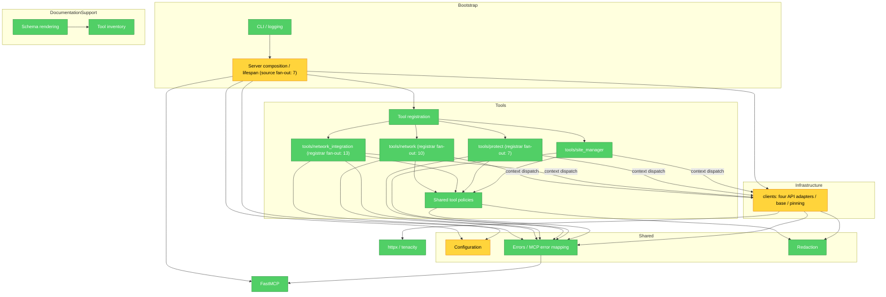

# Brooks-Lint Review

**Mode:** Architecture Audit 
**Scope:** Entire repository at `ae90152`, reviewed 2026-10-27. Static import analysis covered all 56 production Python files (8,507 lines); implementation reading sampled startup, configuration, shared policies, clients, and representative tools across all four API surfaces. Tests, scripts, and architecture documents were sampled; this is not an exhaustive handler or test-quality review. 
**Health Score:** 89/100 — balanced defaults; no `.brooks-lint.yaml` present. 
**Trend:** First run — no trend data.

The architecture is coherent and acyclic, with two confirmed configuration ownership problems and a minor framework dependency leak.

## Module Dependency Graph

Arrows point from consumer to dependency. Nodes group functional modules; client dispatch through the lifespan context is labeled because it is a behavioral dependency rather than a direct tool-module import. External dependencies are representative. Fan-out labels count distinct internal source-module imports, including lazy imports and excluding `TYPE_CHECKING` imports; collapsing modules changes the number of visible arrows.

No runtime import cycles were found. The shared tool module references `ServerContext` only under `TYPE_CHECKING`, so the apparent tools-to-server return edge is not a runtime cycle. The four tool surfaces contain 10 legacy Network, 13 Network Integration, seven Protect, and three Site Manager handler modules. Their registration fan-out and the server's composition fan-out are appropriate orchestration responsibilities.

## Findings

### 🟡 Warning

**R5 — Explicit server configuration stops at tool registration**

**Symptom:** [server.py:229](../src/unifi_mcp/server.py#L229) accepts `create_server(config)` and registers tools from that object, but attaches the global lifespan function. [server.py:115](../src/unifi_mcp/server.py#L115) independently calls cached `get_config()` to build clients and the runtime context. An offline reproduction passed a configuration enabling Site Manager while the patched global loader returned a configuration with no enabled APIs: nine tools remained registered and the lifespan yielded zero clients. The disabling loop only considers APIs enabled in the lifespan's configuration, so it did not hide those tools.

**Source:** *Working Effectively with Legacy Code* — The Seam Model; *The Pragmatic Programmer* — Orthogonality.

**Consequence:** Configuration injection works for tool discovery but fails at startup. Programmatic callers and tests can get tools without corresponding clients, different hosts or keys from those supplied, or runtime write policy that disagrees with registration. Environment-driven CLI startup normally shares the cached settings object, which limits the common-case impact.

**Remedy:** Bind the selected configuration into a lifespan factory or closure in `create_server`, and construct `ServerContext` and clients from that same object. Add a focused regression that starts a server with explicit settings differing from the global loader and checks client configuration, tool visibility, and runtime mode agreement.

**R3 — HTTP logging policy has two configuration authorities**

**Symptom:** [config.py:117](../src/unifi_mcp/config.py#L117) declares `unifi_log_raw_bodies` as a Pydantic setting, but [clients/base.py:63](../src/unifi_mcp/clients/base.py#L63) implements its own environment parser. [clients/base.py:220](../src/unifi_mcp/clients/base.py#L220) consults that helper for each error response, and the server does not pass the settings field to clients. An offline check set the explicit settings field to `True` and the process variable to `false`: the client helper returned `False`.

**Source:** *The Pragmatic Programmer* — DRY; *A Philosophy of Software Design* — Information Hiding and Leakage.

**Consequence:** Logging behavior depends on how configuration is supplied. Values loaded only from `.env` or constructor arguments do not control this behavior; changes to the process environment can alter it independently of cached settings. Maintainers must reconcile two parsers and two lifetimes for one policy governing raw response logging. This confirms inconsistent policy ownership, not a demonstrated secret disclosure.

**Remedy:** Add an explicit client logging-policy argument with a safe default and pass the resolved settings value from the composition root. Remove the environment lookup from the HTTP layer. Direct client callers can use the default or explicitly opt in, preserving standalone construction without a global dependency.

### 🟢 Suggestion

**R5 — Transport exceptions depend on the MCP presentation framework**

**Symptom:** [errors.py:8](../src/unifi_mcp/errors.py#L8) imports FastMCP's `ToolError` in the same module that defines transport exceptions. Every concrete client and the pinning transport import this module, so importing the HTTP adapter layer also loads a presentation-framework dependency. The exception definitions and `handle_client_error` serve different layers.

**Source:** *Clean Architecture* — Dependency Inversion and separation of policy from presentation details.

**Consequence:** Reusing the clients in a standalone probe or changing MCP error presentation carries unnecessary FastMCP coupling. This is minor in a package whose primary purpose is serving MCP, and does not currently prevent isolated HTTP tests.

**Remedy:** Keep exception types in `errors.py` and move `handle_client_error` and its formatting helper to a tool-layer error adapter; update `tools/_common.py` to import that adapter. Preserve existing public imports if downstream callers rely on them.

## Assessment Coverage

| Check | Assessment |
|---|---|
| R5 Dependency Disorder | No runtime cycles. Shared tool helpers have the highest direct internal fan-in (33 modules), followed by errors (25). High registrar fan-out is intentional. Configuration ownership and framework coupling are reported above. |
| R6 Domain Model Distortion | No finding. Network, Network Integration, Protect, and Site Manager reflect upstream contexts. Raw dictionaries are an explicit adapter design documented in `CLAUDE.md` and `CONTEXT.md`; a rich domain model would need a concrete invariant to justify it. |
| R3 Knowledge Duplication | One confirmed policy duplication: raw-body logging configuration. Repeated endpoint wrappers across distinct vendor APIs are justified boundaries. Tool inventory and generated schema documentation have explicit drift guards. |
| R4 Accidental Complexity | No finding. Registration wrappers absorb framework wiring; the base client centralizes HTTP, retries, path handling, and failures. No sampled layer exists solely for speculative future use. |
| R2 Change Propagation | Shared helpers and base transport have broad impact, but that alone is not shotgun surgery. No separate finding: the concrete configuration propagation problem is counted once under R5. |
| R1 Cognitive Overload | No architectural finding. The largest source file is the 628-line base client; size alone does not establish mixed responsibility. API and resource directories give new features a predictable home. |

## Testability Seam Assessment

Tool handlers accept a FastMCP context whose clients can be replaced with doubles (`tests/conftest.py:FakeLifespanContext` and `build_fake_ctx`). Client tests substitute HTTP responses with `respx`, providing a working infrastructure seam despite concrete `httpx.AsyncClient` construction. The shared decorator separately tests write gating, error translation, cancellation, and signature preservation.

The startup configuration seam is incomplete, as described in the first Warning. Lifespan tests patch constructors and the global configuration environment; those tests provide useful coverage but do not prove that `create_server(explicit_config)` controls runtime initialization. No additional seam finding is counted for that same cause.

## Conway's Law Check

[CODEOWNERS](../.github/CODEOWNERS) assigns the repository to one default owner. The available evidence does not establish separate team boundaries or cross-team coordination overhead; no Conway's Law finding is warranted. Actual team communication structure remains unknown.

## Validation and Limits

- Static AST analysis covered all production Python modules, including function-local imports, and separated imports under `TYPE_CHECKING` from runtime imports. Runtime cycle results concern the repository's explicit import graph, not arbitrary dynamic imports or external package internals.
- Two synthetic offline reproductions confirmed the configuration discrepancies without controller access or real credentials.
- Focused verification passed: **169 tests in 20.62 seconds** using `.venv/bin/pytest tests/unit/test_server.py tests/unit/test_server_lifespan.py tests/unit/tools/test_tool_handler.py tests/unit/test_errors.py tests/unit/clients/test_base.py -q`.
- Live integration tests and the full suite were not run. This audit does not certify endpoint correctness or hardware behavior. The pre-existing untracked `docs/codebase-recon-report.md` was left unchanged.

## Summary

First, carry one resolved configuration object through registration, startup, and client logging policy. The dependency structure otherwise supports independent API adapters and isolated tests; retain those boundaries while addressing the two configuration inconsistencies. The score is `100 − (2 × 5) − (1 × 1) = 89`, with zero Critical findings.
