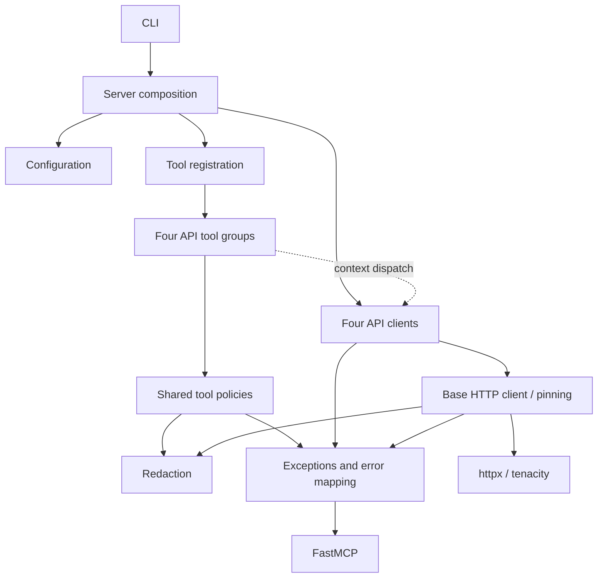

# Brooks-Lint Health Dashboard

**Mode:** Health Dashboard 
**Scope:** Entire `unifi-mcp` repository at `ae90152`; static imports checked exhaustively, implementation and test quality sampled. 
**Composite Score:** **96/100** 
**Trend:** First dashboard run.

| Dimension | Score | Top finding |
|---|---:|---|
| Code Quality / PR | Skipped | No staged, working-tree, or branch diff |
| Architecture | 99/100 | Transport exceptions depend on FastMCP |
| Tech Debt | 90/100 | Configuration has competing authorities |
| Test Quality | 100/100 | No confirmed obscurity or brittleness in sampled tests |

Balanced scoring deducts five points per warning and one per suggestion. Redistributed weights produce `99 × (0.30/0.75) + 90 × (0.25/0.75) + 100 × (0.20/0.75) = 96.27`, rounded to **96**. These are bounded review scores, not release-readiness guarantees.

## Module Dependency Graph

Arrows point toward dependencies; the dotted edge represents runtime dispatch. **No runtime import cycles found.** High registrar fan-out is appropriate composition work.

## Top Findings

### Warning — R2: Explicit configuration stops before startup

**Symptom:** [create_server](../src/unifi_mcp/server.py#L229) registers tools using supplied settings, while the lifespan independently calls global `get_config()`. An offline reproduction left **nine visible tools with zero runtime clients**.

**Source:** *The Pragmatic Programmer* — Orthogonality; *Working Effectively with Legacy Code* — Seam Model.

**Consequence:** Programmatic callers can receive tools whose clients, hosts, or runtime mode disagree with their supplied configuration. Ordinary environment-driven CLI startup limits the common-case impact.

**Remedy:** Bind the selected configuration into the lifespan and test startup with explicit settings differing from global settings.

### Warning — R3: Logging policy has two authorities

**Symptom:** [config.py](../src/unifi_mcp/config.py#L117) defines `unifi_log_raw_bodies`, but [base.py](../src/unifi_mcp/clients/base.py#L63) separately reads the process environment. An offline reproduction returned `True` from settings and `False` from the client helper.

**Source:** *The Pragmatic Programmer* — DRY; *A Philosophy of Software Design* — Information Leakage.

**Consequence:** Constructor and dotenv settings do not reliably control HTTP error-body logging.

**Remedy:** Pass the resolved policy explicitly into clients, retaining a safe default for standalone construction.

### Suggestion — R5: Transport exceptions load the presentation framework

**Symptom:** [errors.py](../src/unifi_mcp/errors.py#L8) combines client exception definitions with FastMCP `ToolError` mapping.

**Source:** *Clean Architecture* — Dependency Inversion.

**Consequence:** Standalone client reuse carries unnecessary framework coupling; current impact is small.

**Remedy:** Move MCP error translation into a tool-layer adapter while preserving supported imports.

## Validation and Recommendation

**1,630 unit and property cases passed in 53.80 seconds.** The static suite map contains 937 unit test functions, eight property functions, 105 integration functions, and six subprocess transport functions, before parametrization. Live hardware and transport suites were not run.

Fix configuration ownership first: bind startup to the supplied settings, then pass logging policy explicitly. Tech debt is the weakest dimension and merits the fuller `brooks-debt` prioritization workflow. No production code changed; the dashboard score was appended to [.brooks-lint-history.json](../.brooks-lint-history.json).
